# AI-Assisted Elementary Math Olympiad Practice

English | [Chinese guide](README.zh-CN.md)

> **License:** Free for noncommercial personal learning, research and teaching. Commercial use requires prior written authorization from **ystok66**. [English terms](LICENSE.md) | [Chinese license](LICENSE.zh-CN.md). Third-party dependencies and question-bank content retain their own rights. This is a source-available, noncommercial project, not an OSI-approved open-source release.

> **LANGUAGE CANDIDATE, NOT FULLY ACCEPTED.** Known failures and NOT_RUN cases remain. This banner supersedes the older validation claims below. Do not replace the accepted release. See [acceptance evidence](docs/LANGUAGE_ACCEPTANCE_REPORT.md) and [language settings](docs/LANGUAGE_SETTINGS.md).

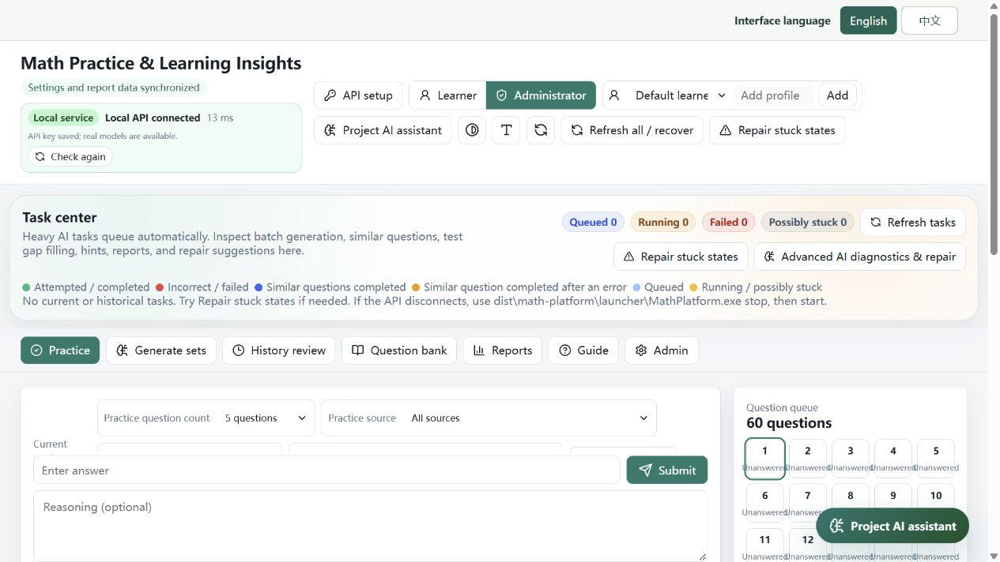

*Main interface: workspace navigation and the task center in the local demonstration installation.*

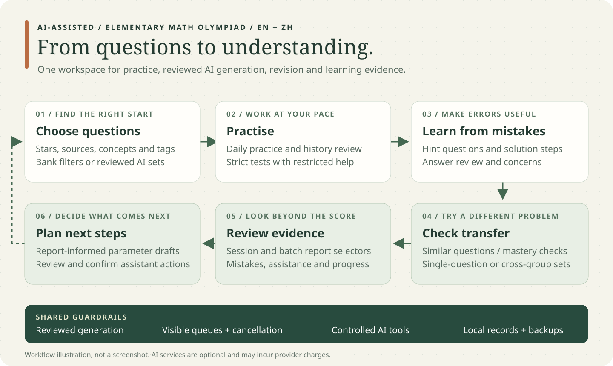

*Overview illustration: a learning workflow, not a screenshot or a claim of measured learning outcomes.*

**An AI-assisted elementary math olympiad practice platform with a searchable question bank, reviewed question generation, targeted revision, and learning reports.**

**Who it is for:** elementary (primary-school) learners practising math olympiad and competition-style reasoning, supported by parents or teachers. Star ratings indicate problem difficulty, not school grade; choose questions to match the learner's current foundations. `MathPlatform` remains the internal application and executable name.

## At a glance

| Feature | Why it exists |
| --- | --- |
| A searchable question bank with sources, stars and tags | Find suitable questions without repeatedly organising spreadsheets or documents. |
| Regular practice, generated sets, history review and strict tests | Separate daily learning, targeted revision and assessment without fragmenting the learner's records. |
| Rule-based grading plus AI-supported review | Handle more than a single numeric answer while keeping straightforward checks deterministic. |
| Learning-oriented hint questions, explanations and similar questions | Help learners build understanding, then check whether they can transfer it to a new problem. |
| Reviewed AI question generation and reusable question pools | Reduce repetitive preparation while keeping a review step before publication. |
| Reports and report-driven practice planning | Turn past answers into an understandable next practice plan instead of only displaying a score. |
| A project AI assistant with permission-controlled tools | Let parents find features and prepare operations in natural language rather than memorising IDs and parameters. |
| A task centre, cancellation and recovery controls | Make background work visible and reduce the need to restart or reinstall when an operation gets stuck. |
| A portable desktop distribution and first-run API setup | Let users copy a complete folder, start the app, and select provider-advertised models rather than typing model IDs. |
| English and Chinese interfaces | Support different language preferences while retaining original imported question content. |

**Design purpose:** Connect question discovery, practice, learning from mistakes, transfer checks, reports and the next practice plan while reducing administration for parents and teachers. AI supports generation and explanation; deterministic code remains responsible for rule-based grading, task state, permissions and data protection. This is a learning aid, not an infallible judge or a multi-user online teaching platform.

## Contents

- [Release status and choosing a download](#release-status-and-choosing-a-download)
- [Windows quick start](#windows-quick-start)
- [macOS packages](#macos-packages)
- [First-run API setup](#first-run-api-setup)
- [Workspaces and daily workflow](#workspaces-and-daily-workflow)
- [Answers, hints and explanations](#answers-hints-and-explanations)
- [AI generation and similar questions](#ai-generation-and-similar-questions)
- [Reports and the project assistant](#reports-and-the-project-assistant)
- [Tasks, cancellation and recovery](#tasks-cancellation-and-recovery)
- [Data, privacy, backup and migration](#data-privacy-backup-and-migration)
- [Troubleshooting](#troubleshooting)
- [Developer and maintainer notes](#developer-and-maintainer-notes)
- [Testing boundaries and known limitations](#testing-boundaries-and-known-limitations)
- [Chinese guide](README.zh-CN.md)

## Release status and choosing a download

This README describes the public-release preparation updated on **2026-10-17**.

| Distribution | Intended user | Entry point | Current evidence |
| --- | --- | --- | --- |
| Windows x64 portable ZIP | Normal Windows users, including Intel and AMD x64 PCs | `StartMathPlatform.exe` or `START_HERE.cmd` | Built; isolated startup, first-run UI, mock-provider flow and one real provider call tested. |
| Repository source / GitHub source ZIP | Developers and maintainers | Build scripts | Source only; not the ready-to-run application. |
| macOS Apple Silicon (`arm64`) | M-series Mac users | `MathPlatform.app` | Native build workflow supplied; no completed native build or Mac runtime test in this local preparation. |
| macOS Intel (`x86_64`) | Intel Mac users | `MathPlatform.app` | Native build workflow supplied; no completed native build or Mac runtime test in this local preparation. |

**Do not confuse a prepared build workflow with a finished Mac download.** Mac packages must first be built successfully on the corresponding macOS runner. This preparation has not uploaded a repository or published a GitHub Release.

The Windows CMD and EXE entries start **the same application and the same local database**. They are two entry methods, not different feature editions. `StartMathPlatform.exe` is a small launcher, not an installer containing the entire question bank.

For end users, download the appropriate **Release asset**, not GitHub's **Code > Download ZIP**. Extract the whole archive before opening it. Do not run it inside an archive viewer.

## Windows quick start

1. Extract `MathPlatform-Windows.zip` to a normal writable folder, for example `C:\MathPlatform\math-platform`.
2. Keep the entire extracted directory together.
3. Double-click `StartMathPlatform.exe`. Alternatively, double-click `START_HERE.cmd`.
4. Wait for the local services to become ready. The app opens in your browser.
5. Configure a provider in the first-run dialog, or choose **Not now** to use the existing question bank without AI.

The portable package includes the API runtime and Node runtime. Users do **not** need to install Python or Node separately. A browser is still required. Windows ARM devices have not been tested; this package targets x64.

Use a folder where your account can write data. Avoid running from a read-only disk, a temporary archive extraction, or a cloud-synchronised folder while services are running. Do not move the folder while the application is open.

### What must stay together?

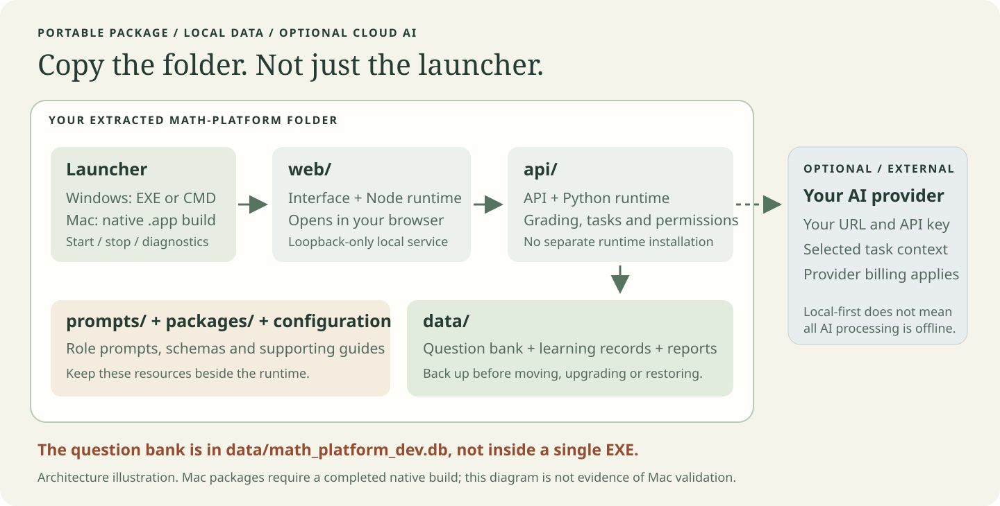

*Copy the complete extracted folder, not just the EXE. The diagram explains the package structure; it does not imply that a native Mac build has already been produced.*

```text
math-platform/
  StartMathPlatform.exe      Double-click entry
  START_HERE.cmd             Alternative CMD entry
  check.cmd                 Local diagnostics
  stop.cmd                  Stop this installation's services
  launcher/                 Lifecycle and diagnostic tools
  api/                      Packaged backend and Python dependencies
  web/                      Packaged frontend and Node runtime
  data/                     Question bank and local application data
  prompts/                  AI role prompts and language variants
  packages/                 Shared schemas and supporting resources
  question_data/            Rating/tagging guidance
  .env                      Local runtime configuration; do not publish your used copy
  README.md
```

**Copy the whole folder, not just an `.exe`.** The question bank is stored in `data/math_platform_dev.db`. Executables load that database; they do not embed your bank or answer history.

The usual local addresses are `http://127.0.0.1:3000` for the web interface and `http://127.0.0.1:8001` for the API. The launcher can choose fallback ports when defaults are occupied. Prefer the address opened by the launcher or returned by `check.cmd`; do not assume an old bookmark points to the current installation.

### Stopping and diagnosing the Windows package

Run these from the extracted package directory when needed:

```cmd
launcher\MathPlatform.exe status --json
launcher\MathPlatform.exe doctor --json
launcher\MathPlatform.exe diagnostic --json
launcher\MathPlatform.exe stop
launcher\MathPlatform.exe start
```

`start` returns after dispatching the services; it is not a readiness test. Use `status` or `doctor` separately. Closing the browser does not necessarily stop the local services. `stop.cmd` or the launcher `stop` command does.

## macOS packages

The intended end-user packages are self-contained, architecture-specific folders:

| Your Mac | Package produced by the workflow |
| --- | --- |
| Apple Silicon / M-series | `MathPlatform-macOS-arm64.zip` |
| Intel | `MathPlatform-macOS-x86_64.zip` |

After a package has been built and released, extract it, move the **entire folder** to a writable location, and open `MathPlatform.app`. `START_HERE.command`, `STOP.command` and `CHECK.command` provide alternative lifecycle entries. The package includes both language runtimes; the end user does not need Python, Node, Homebrew or a local compilation step.

The supplied workflow targets native macOS 15 runners. Older macOS compatibility is not claimed. Do not rename a Windows EXE to make a Mac app or use the old developer-only `BUILD_OFFLINE_PACKAGE_ON_THIS_MAC.command` as an end-user distribution.

**Signing limitation:** the build is not Apple-notarized. macOS may require a per-app security approval on first launch. Do not disable Gatekeeper globally. Maintainers need appropriate Apple signing/notarization credentials to provide the usual notarized distribution experience. See [Apple's guidance on opening apps safely](https://support.apple.com/en-ie/102445).

Mac startup, port fallback, stop and database diagnostics have a separate native launcher. Windows-specific backup/restore launcher commands are not advertised as Mac commands. Use the application's export workflows and a stopped-folder backup until Mac-specific maintenance features are separately validated.

## First-run API setup

The dialog appears after the local API is ready when there is no saved API key. Reopen it later with **API setup** at the top of the page.

1. Enter an **OpenAI-compatible Chat Completions API base URL**. Use the provider's API endpoint, not its account-login website. Keep `/v1` if that provider requires it.
2. Enter your API key. No shared key is included in the public package.
3. Select **Connect & fetch models**. The app asks the provider for its advertised model list.
4. Search the list and select a model from the dropdown.
5. Select **Test an actual model call**. This sends one short chat request with an output limit of 64 tokens. Your provider may charge for it.
6. After a nonempty reply succeeds, select **Save & start**.

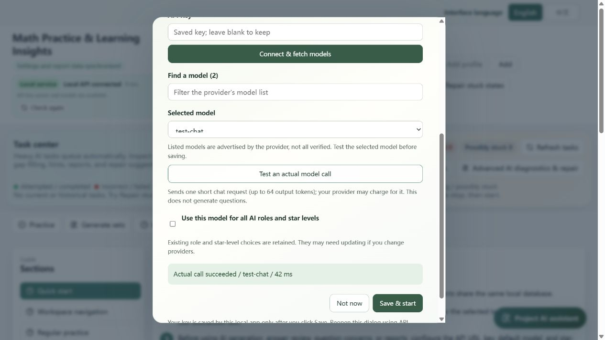

The screenshot uses a test-only model, not an included commercial account.

### Important setup behaviour

- Model discovery is not proof that every listed model supports chat, is affordable, or is enabled for your account. Only the selected model is tested.
- An empty assistant response is treated as a failed test, not as a successful connection.
- Changing the URL, key or model invalidates the previous successful test.
- The key draft is not stored in browser storage. Persistence happens only when you select **Save**.
- An existing saved key is not automatically sent to a newly entered provider address. Enter a key for that new address.
- Cancel stops the local wait and ignores late UI results. It cannot guarantee that the remote provider stops or refunds a request already received.
- English and Chinese can be selected inside the dialog.
- A provider without a compatible `/models` endpoint cannot complete automatic discovery through this wizard. Check the provider's API documentation or the detailed model settings; do not assume every service is compatible.

For a fresh setup, **Use this model for all AI roles and star levels** is selected by default. This replaces role/star overrides and the reviewer model allowlist, and clears stale pricing settings. It does not remove review steps or bypass strict-review independence requirements. Configure separate generator/reviewer models in **Admin** when required.

When reopening an existing setup, role overrides are retained by default. If you change providers, check those overrides: a model name valid at the old provider may not exist at the new one. Provider-specific names such as `gpt-5.6-sol` are not guaranteed to exist on every compatible endpoint.

## Workspaces and daily workflow

> **About the screenshots:** captured from an isolated local demonstration installation. The example practice contains three unattempted questions, not a child's learning record. Existing source-bank questions retain their original Chinese text even when the interface is English. These images show controls and navigation, not successful paid AI calls or completed end-to-end tests. The first-run connection image below comes from an earlier local mock-provider test.

<details>
<summary>Question bank: browse tags, filters, question lists, and question details</summary>

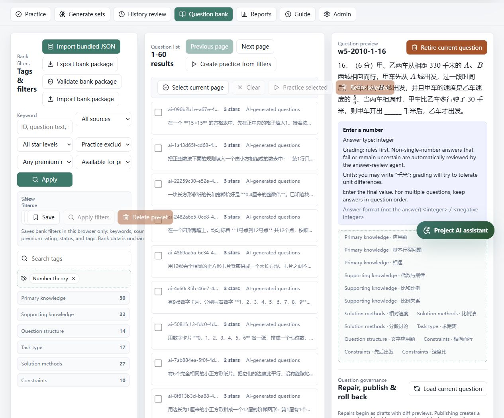

*Use the bank workspace to discover existing questions before choosing a practice or generation workflow. Selecting a question does not start an AI call.*

</details>

The application is local and primarily intended for a single household/operator, with selectable learner profiles. Learner profiles separate learning records; they are not independent authenticated accounts or a security boundary.

| Workspace | Main use | Suggested workflow |
| --- | --- | --- |
| Practice | Daily question-bank practice and strict tests | Pick learner, stars, sources, tags and attempted/unattempted preference; choose a count; start. |
| Generate sets | Create or reuse a coherent AI practice set | Choose generation parameters, start a batch, watch progress, then start/synchronise its practice session. |
| History review | Find prior sessions/batches and revisit selected problems | Select a historical group, review errors, select questions across groups, and create review or similar-question practice. |
| Question bank | Search, inspect and maintain reusable questions | Filter by source, difficulty and tags; inspect details; import/export or use guarded maintenance actions. |
| Reports | Statistics, learning evidence and AI summaries | Select a session or generation batch visually, then request the appropriate report. |
| Guide | In-application instructions | Use the section list for detailed explanations of controls and workflows. |
| Admin | Provider models, imports/exports, diagnostics and protected maintenance | Configure carefully; inspect impact before destructive actions. |

### Four practice modes

<details>
<summary>Regular practice: selection controls, learning tools, and the question queue</summary>

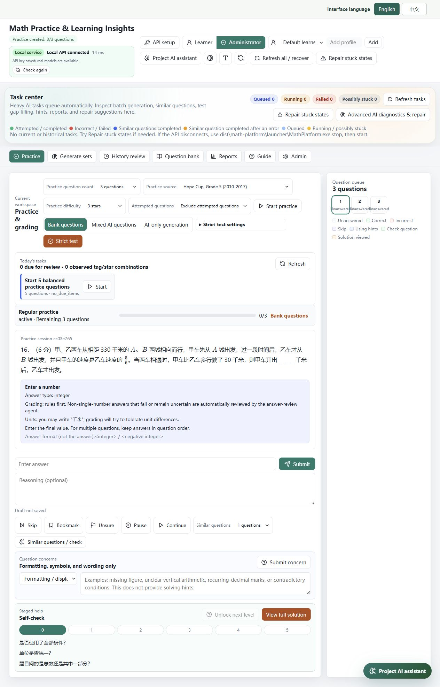

*A three-question demonstration session with no submitted answers. The queue and navigation belong to the session; the selected question has its own answer and assistance controls.*

</details>

<details>
<summary>Strict-test setup: question count and custom star proportions</summary>

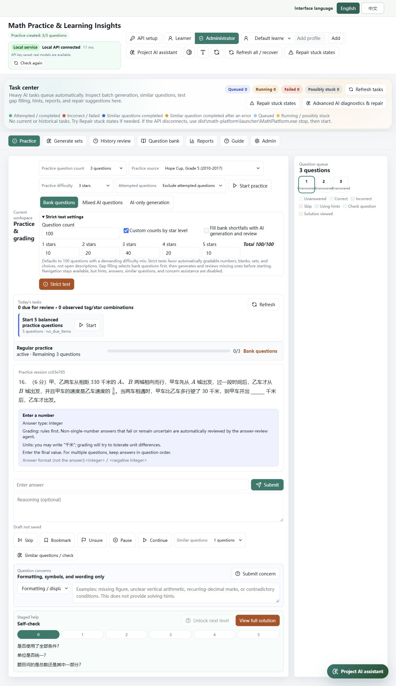

*The screenshot shows configuration only. No strict test or AI top-up was started for this documentation capture.*

</details>

| Mode | Where questions come from | Teaching assistance | Records |
| --- | --- | --- | --- |
| Regular practice | Filtered question bank | Available | A new practice session |
| Generated-set practice | Accepted questions from a generation batch | Available | A practice session linked to its batch |
| History review | All, weak, incorrect or selected questions from history | Available | A new review session; not a replacement for the original score |
| Strict test | Selected distribution of bank questions, optionally reviewed AI gap filling | Assistance is restricted | A separate assessment session |

In non-strict modes, use the question navigator or **Previous / Next** controls to move through the queue. Answering a question and moving to the next question are separate actions. A generated batch is not automatically a completed practice session: select the action to start or synchronise practice first.

Strict tests allow a question count and star-level distribution. If the available bank cannot satisfy the requested distribution, adjust it or explicitly permit AI gap filling. AI supplementation is queued and reviewed; it is not an unreviewed shortcut. Hints, answer viewing, explanations and similar-question assistance are restricted during the test.

### Status colours

Question and task areas include legends. Read the status label as well as the colour. Categories include attempted/completed, incorrect/failed, similar questions completed, similar questions completed after an error, queued, and running/possibly stuck. A later successful similar question is not the same evidence as an initially correct original answer.

## Answers, hints and explanations

The expanded [practice screenshot](docs/images/practice.jpg) shows answer entry, optional reasoning, similar-question controls, question concerns, and staged help together. These are separate actions, not interchangeable ways of revealing an answer.

### Entering an answer

The answer-format guide under the question explains the expected structure. Examples such as `12`, `3/5`, `{2,4,6}` or `A` demonstrate formatting; they must not be taken as that question's answer. Tuple order and set membership are different, so follow the format shown for the current question.

Deterministic grading handles supported answer structures first. For applicable non-single-number or equivalent-expression cases that are not accepted by the rules, AI review can provide an additional judgement when configured. An unavailable provider must not be interpreted as proof the learner is wrong. Units are generally not the focus of the answer check; an unambiguous mathematical value or structure still matters.

Where an answer-reasoning field is available, a learner can add their method. That can make subsequent assistance more relevant. It is optional; avoid entering names, contact details or other unnecessary personal information.

### Assistance tools are not interchangeable

| Tool | Purpose |
| --- | --- |
| AI answer review | Reconsider the submitted answer and supported equivalence cases. |
| Question concern | Raise a possible ambiguity, wrong answer or problematic statement for review. |
| Hint question / staged help | Offer a small learning-oriented question informed by the original problem and the learner's available attempts/reasoning. |
| View answer | Reveal the answer deliberately; it must not count as independent success. |
| Solution explanation | Explain the solution in understandable steps rather than just display a final value. |
| Similar question / mastery check | Generate a new problem with the same core skill but a different surface form to check transfer. |

Hint questions are designed as temporary learning support, not ordinary additions to the reusable question bank. Similar/mastery-check questions are a separate flow and can be retained for practice and history. Do not equate “I completed a hint” with “I independently mastered the original question.”

Generation prompts require structured solution steps, understandable elementary explanations, and review of correctness, completeness and skipped reasoning. Clear wording should clarify what the question asks without inserting the key solving trick or lowering the intended difficulty. These constraints reduce errors; they do not guarantee a mathematically perfect AI output.

## AI generation and similar questions

### Generating a set

<details>
<summary>Generation workspace: tags, stars, concurrency, reuse, and budget</summary>

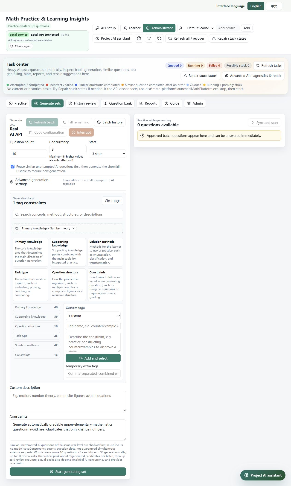

*This is a prepared form, not a completed generation batch. Review the requested count, reuse setting, and call budget before starting.*

</details>

1. Open **Generate sets** and choose the question count and difficulty.
2. Select relevant sources/tags and any custom constraints.
3. Decide whether to reuse eligible, previously generated AI questions.
4. Check candidate count, reviewer settings, concurrency and budget estimates.
5. Submit once and watch the task/batch state.
6. Start or synchronise practice when accepted questions are available. More accepted questions can be appended while generation continues.

An operation may create multiple candidates and ask the reviewer to select an acceptable one. Candidate count is configurable; do not infer the current setting from an old screenshot. Model roles and star-specific model selection can be configured in **Admin**.

**Why can generation be very fast?** With reuse enabled, some slots may be filled from eligible existing AI questions without another generation call. The UI distinguishes reuse from newly generated questions. Disable reuse if the purpose is to obtain new model output. That increases latency and may increase cost.

**Why can rejected attempts exceed the requested question count?** The requested count is the desired number of accepted questions, not the maximum number of candidates or provider calls. A slot can require multiple attempts and reviews. Rejections, provider failures and completed questions must be interpreted separately. Reaching a budget or attempt limit can leave a partially completed batch.

### Similar questions from one or several originals

<details>
<summary>History review: choose originals and build a similar-question basket</summary>

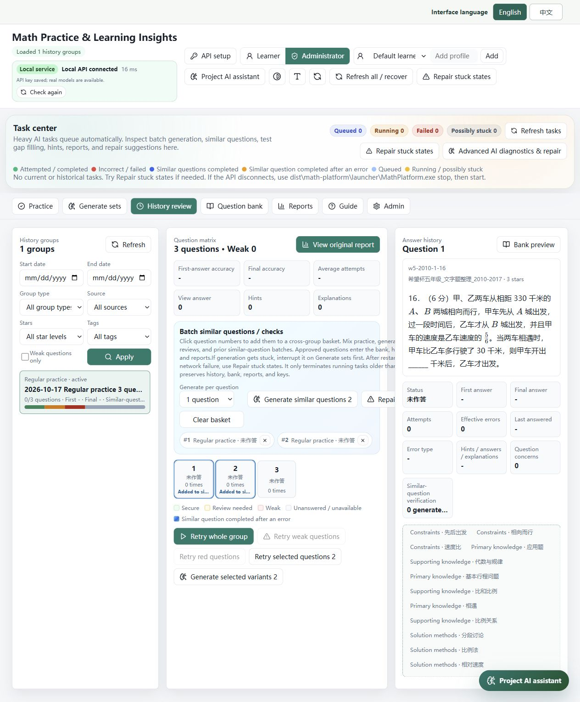

*Two questions are selected from the demonstration history group. The basket is a selection preview; generation was not started. Selection can be adjusted before confirmation.*

</details>

Use **Similar question / mastery check** for an individual problem. In **History review**, use the cross-group selection basket to choose several originals, remove unwanted selections, and request a batch of similar questions. Selection is not generation: inspect the basket and request before starting paid work.

The generation and review prompts have distinct responsibilities: the generator constructs candidates and structured solutions; the independent reviewer checks correctness and suitability before accepted candidates are published. Repeated actions and late responses are guarded by idempotency, uniqueness and cancellation checks. Those protections are not a guarantee that every external request can be remotely cancelled.

### Costs and throughput

- Your provider account pays for external requests. The desktop bundle does not include API credit.
- Candidate generation, reviews, hint generation, AI reports and assistant tool loops can each incur calls.
- Per-batch concurrency is limited to 8 for ordinary generation and 4 for batch similar questions; shared scheduling/provider limits also apply.
- Starting two batches with concurrency 8 does not promise 16 simultaneous provider calls. Heavy work is queued and constrained globally.
- Pricing estimates depend on configured provider prices and model behaviour. They are not a billing guarantee.
- To investigate a failure cheaply, start with one question or one short model test, not a large batch.

## Reports and the project assistant

### Choosing a report target without typing an ID

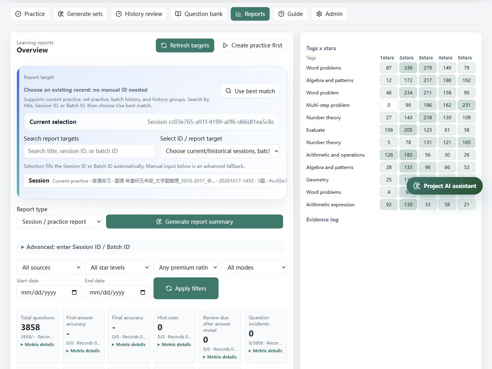

*Search or select a session/batch instead of copying an opaque ID. This example session has no submitted answers, so its empty learning statistics are not an AI report or evidence of student performance.*

Open **Reports**, choose the report type, and use the searchable report-object list and direct selection control. Available objects come from current practice, generated-set practice, batch history and historical groups. Select a matching object to populate the Session ID or Batch ID automatically.

Search can use the title or identifier. **Use best match** selects a matching available object; review its title/type before generating a report. This is a selection aid, not a guarantee of semantic understanding. If the list is empty, refresh it and confirm that the relevant session or batch exists for the selected learner.

| Object | What it represents | Useful for |
| --- | --- | --- |
| Generation Batch ID | A request to produce a set and its slot outcomes | Generation progress, acceptance/rejection and batch-level reporting |
| Practice Session ID | A learner's practice/test/review session | Answers, mistakes, assistance use and learning analysis |
| History group | A browsable grouping of past work | Selecting review targets and finding related records |

Generating questions without attempting them does not create evidence of the learner's strengths or weaknesses. A report over an unattempted set cannot honestly assess mastery.

### Report-driven next practice

The project assistant can inspect available report/history summaries, extract weak concepts or tags, and prepare a targeted generation draft. The intended flow is **analyse report > review parameter draft > confirm generation > practise > review evidence**. Preparing the draft does not itself start paid question generation.

### Project AI assistant

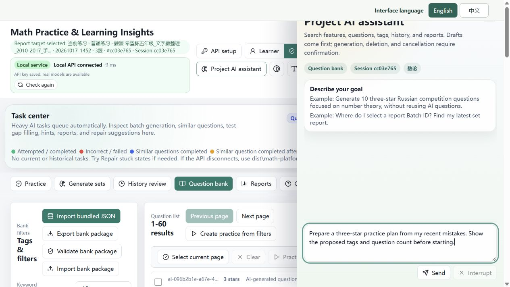

*The example request is deliberately unsent. The image illustrates the assistant entry point and input flow; it does not fabricate a model answer, executed tool, or approval.*

Open the global assistant from any workspace. Examples:

- “Where do I choose a report Batch ID?”
- “Find three-star Russian competition questions about number theory.”
- “Prepare ten questions on these weak concepts, without reusing AI questions.”
- “Find the last practice session and prepare a parent-friendly report.”
- “Explain this stuck task and show the safe recovery options.”

The assistant can query supported question/tag/history/report/task tools and prepare drafts that can be applied to the relevant form. It receives a limited project/page context and sanitised summaries through allowlisted tools, not unrestricted access to your computer.

### Permissions and confirmations

| Operation | Permission model |
| --- | --- |
| Read supported summaries, search or prepare drafts | Can run without a destructive-action confirmation |
| Start generation, create reports or execute other consequential tools | Review the proposed action and confirm where requested |
| Cancel/retry tasks or perform repairs | Controlled tools, visible results and audit records |
| Remove eligible AI-generated questions | Confirm the impact; referenced records may be retired rather than hard-deleted |
| Remove non-AI questions | Additional dynamic authorisation; not a free-form assistant instruction alone |
| Arbitrary SQL, shell commands, secret extraction or bypassing question review | Not granted to the assistant |

The assistant is distinct from the emergency recovery agent. Neither should be treated as capable of repairing arbitrary source-code bugs. A duplicate-data repair can address supported state inconsistencies; a recurring program defect still needs a developer fix and a new build.

## Tasks, cancellation and recovery

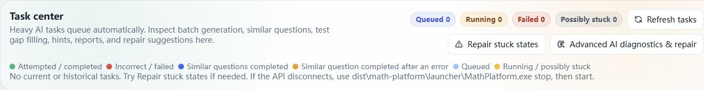

*The demonstration queue is idle. Running or queued work belongs here; cancellation and recovery are explicit actions, not a reason to reinstall the application.*

The task centre shows queued, running, cancelling, cancelled, failed and potentially stale/recoverable work. Use its labels and timestamps rather than repeatedly clicking a busy generation button.

### Recommended recovery order

1. Check whether the operation is legitimately **queued** behind another heavy task.
2. Cancel an unwanted task from the task/batch controls and wait for its state to update.
3. Use **Refresh all / recover** if the browser view is stale.
4. Use **Repair stuck states** for deterministic recovery of supported stale task/batch/help states. It is intended to preserve the bank, history and keys.
5. If the local API is unavailable, use the packaged launcher to stop and restart this installation. An in-page button cannot operate an API process that is completely down.
6. If routine recovery cannot resolve a supported problem, inspect the diagnosis and explicitly choose **Advanced AI diagnostics & repair**.
7. Preserve a diagnostic package and report the issue if it recurs. Do not reinstall over your only copy of the database.

The emergency recovery agent has an independent, bounded execution path, up to 10 rounds, and only controlled actions. It cannot execute arbitrary SQL, delete your database, change secrets or publish unreviewed questions. You can interrupt it; interruption prevents further rounds but does not roll back already completed safe actions.

Cancelling a generation stops further local dispatch/publication according to the task's state checks. Work already sent to a provider may still cost money. Restarting the browser or shutting the computer down is not a reliable provider-side cancellation mechanism.

SQLite transactions and stale-state recovery reduce interruption risks, but cannot guarantee recovery from disk failure, corrupt storage or every possible power loss. Keep backups. A progress label is not a substitute for a backup.

## Data, privacy, backup and migration

### What is local, and what can leave the machine?

- The question bank, learner records, task history and reports are stored locally in the package's database/data directory.
- Rule-based practice and local browsing do not need an AI provider.
- AI features send the context needed for that feature to the provider you configure. That may include question text, relevant answers/reasoning and selected history/report summaries.
- “Local-first” does not mean “all AI processing stays offline.” Review your provider's data policy before using children's information.
- The public preparation removes private learner/history/configuration records and starts with an empty API key. Your later used installation is no longer a clean public distribution.
- On Windows, protected configuration may depend on the Windows account/machine. On another computer, be prepared to re-enter the key.
- The Mac path uses local configuration protection and restrictive file permissions, not Windows DPAPI or a claim of Keychain-backed storage. Protect the entire folder and your user account.

Do not upload a used `.env`, database, diagnostic log bundle or backup to a public issue without reviewing/redacting it. A diagnostic archive may contain identifiers and operational details even when obvious credentials are removed.

### Three different export/backup purposes

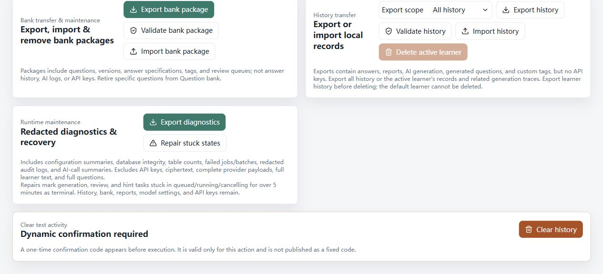

*Bank export, history export, and diagnostics serve different purposes. The screenshot only shows their entry points; no import, export, recovery, or deletion was executed during capture.*

| Operation | Intended use |
| --- | --- |
| Question-bank import/export | Transfer or maintain question content and metadata using the application's supported schema |
| History import/export | Transfer learning records through the supported application workflow |
| Full stopped-folder copy / launcher backup | Preserve a complete local installation or recovery snapshot |

Use the template/schema and validation feedback shown by the import screen. A Word document or arbitrary spreadsheet is not automatically a valid bank import file. Import/export is not a way to transfer a plaintext API key.

### Windows backup and restore

From the package directory:

```cmd
launcher\MathPlatform.exe backup --json
```

Use the actual backup path/name returned by that command. First inspect a restore without applying it:

```cmd
launcher\MathPlatform.exe restore --file "backups\backup-YYYYMMDD-HHMMSS" --dry-run --json
```

After checking the result, stop services and restore with the matching confirmation name:

```cmd
launcher\MathPlatform.exe stop
launcher\MathPlatform.exe restore --file "backups\backup-YYYYMMDD-HHMMSS" --confirm "backup-YYYYMMDD-HHMMSS" --json
```

The Windows backup workflow uses SQLite's online backup API and produces a manifest, database hash, integrity results and a sanitised environment summary. It does not promise that encrypted credentials will be portable across Windows accounts or computers.

### Moving to another computer or updating

1. Stop the original installation and create a backup.
2. Copy the entire folder, including `data/`, rather than individual executables.
3. Use the correct platform/architecture package. Do not run Windows binaries on macOS.
4. Re-enter and test the provider key if protected settings cannot be decrypted on the new machine.
5. Launch from the copied folder, use its opened browser address, and check the release/diagnostic information.
6. Keep the original copy until your records are confirmed on the new installation.

Do not overwrite a used `data/` directory with the clean database from a public release. For an upgrade, preserve your backup and use the project's supported migration/import route. Cross-platform migration should use supported exports/imports and a fresh key setup rather than blindly transplanting encrypted configuration.

## Troubleshooting

| Symptom | Likely explanation | What to do |
| --- | --- | --- |
| `API proxy failed`, `ECONNREFUSED 127.0.0.1:8001` | API not ready, stopped, crashed, or a stale process/port mismatch | Run `check.cmd`; inspect ownership/readiness; stop and start this package. An API-key error is not the same as a refused local TCP connection. |
| Browser opens before the API is ready | Cold startup may take longer than web startup | Wait for local status, then use **Check again**. Repeated generation clicks do not speed startup up. |
| A copied computer shows an old interface | Old service, bookmark, extracted folder or incomplete copy | Stop the old installation, launch the new full folder, and use the URL it opens. Check package identity before replacing data. |
| Fetching models fails | Wrong API URL/key, unreachable provider, missing `/models`, TLS/certificate problem | Check the provider's API endpoint and permissions. Never disable TLS certificate verification as a fix. |
| Models are listed but the actual test fails | Listed model may not support chat or your account's parameters/quota | Select a chat-capable model and inspect the error. Empty output is intentionally rejected. |
| Generation instantly fills some slots | Existing eligible AI questions were reused | Inspect reuse/new counts; turn reuse off when you need new generation. |
| Many rejected attempts | Candidates failed review, generation constraints are too tight, or provider calls failed | Inspect rejection reasons and budgets; try a small controlled batch rather than increasing concurrency. |
| A report list is empty | No matching session/batch, wrong learner/type, or stale list | Refresh, select the learner and object type, and create/start the appropriate work first. |
| Cancelled work still appears on a provider bill | The remote request was already dispatched | Local cancellation cannot reverse external billing. |
| Mac asks to install Python | A source/developer script was downloaded, not a portable runtime | Use a completed matching Mac release asset when available. |
| Mac blocks first launch | Distribution is not notarized | Follow Apple's per-app safety workflow only if you trust the download; do not globally disable protection. |

When asking for support, include the platform, package version, operation, task/session/batch IDs, visible error and approximate time. Attach a reviewed diagnostic summary. Do not attach your key or an unreviewed student database.

## Developer and maintainer notes

### Architecture

| Area | Location / technology |
| --- | --- |
| Web interface and same-origin API proxy | `apps/web`, Next.js / React / TypeScript |
| API and business logic | `apps/api`, FastAPI / SQLAlchemy |
| Local data | SQLite in the portable data directory |
| Role prompts and language resources | `prompts/` |
| Shared schemas/resources | `packages/` |
| Windows lifecycle launcher | `tools/launcher/` |
| Clean public preparation | `scripts/pack/prepare_github_release.py` and `finalize_public_release.py` |
| Native Mac build | `scripts/pack/build_public_macos.py` |
| Mac CI workflow | `.github/workflows/build-public-macos.yml` |

The original maintainer workspace and the sanitised public repository are different products. Public source excludes private settings, dependencies, personal history and build output. The optional `release-data/question-bank.sqlite.gz` is an explicitly sanitised bank snapshot used by the Mac builder, not a copy of a used installation's private database.

### Windows checks and builds

Building from source requires a development environment with Python, Node/npm and the API dependencies. Those requirements apply to maintainers, not portable-package users. A successful frontend build alone is not a TypeScript validation: run the separate check command as well.

Use `tools/run-bounded.ps1` for finite work on Windows. Example from the repository root:

```powershell
& .\tools\run-bounded.ps1 -Command "npm run check -- --incremental false" -TimeoutSeconds 180 -WorkingDirectory (Join-Path (Get-Location) "apps\web") -Name "web-check"
& .\tools\run-bounded.ps1 -Command "npm run build" -TimeoutSeconds 300 -WorkingDirectory (Join-Path (Get-Location) "apps\web") -Name "web-build"
& .\tools\run-bounded.ps1 -Command "powershell -NoProfile -ExecutionPolicy Bypass -File scripts\pack\build_api_exe.ps1" -TimeoutSeconds 360 -Name "api-build"
& .\tools\run-bounded.ps1 -Command "powershell -NoProfile -ExecutionPolicy Bypass -File scripts\pack\build_start_exe.ps1" -TimeoutSeconds 180 -Name "entry-build"
```

The public-preparation script also requires a built lifecycle launcher, packaged Node runtime and a source question bank; it is not a universal clean-checkout installer. Check its arguments and prerequisites before running it. Use a fresh output directory. Do not run an old release-building script over your only used data directory.

Keep services in the background through their launcher. Do not automate `.cmd` files containing `pause`. Start, health-check, test and stop as separate bounded operations. On a timeout, preserve logs and clean only the owned release processes before at most one deliberate retry. Never kill every `python`, `node` or `math-api` process on the computer.

### Building the Mac assets on GitHub

1. Put the prepared `repository/` contents at the root of your GitHub repository, including hidden `.github/` files and the authorised sanitised bank snapshot.
2. Enable Actions for that repository.
3. Open **Actions > Build macOS portable packages > Run workflow**.
4. The workflow builds natively on `macos-15` for `arm64` and `macos-15-intel` for `x86_64`.
5. It installs build-time tools on the runner, builds API/app/frontend, bundles Node, and performs bounded lifecycle smoke checks against a disposable clone.
6. Download the successful architecture's ZIP and SHA-256 artifact. A failed job is not an approved release.
7. Perform a real Mac first-launch/browser check before presenting it as fully validated, and attach the ZIP to a GitHub Release when ready.

The workflow does not require your LLM API key, does not make paid model calls, and does not automatically publish a public Release. It uses read-only repository permissions. GitHub Actions availability, minutes and storage depend on your account/repository; no unlimited-free-build promise is made.

PyInstaller packages are built on the target operating system; a Windows build is not a Mac executable. See the [PyInstaller documentation](https://pyinstaller.org/en/stable/) and [GitHub-hosted runner reference](https://docs.github.com/en/actions/reference/runners/github-hosted-runners).

### Prompts and language

The interface defaults to English and supports switching to Chinese. AI generation uses the corresponding prompt/language constraints so newly generated question statements and solutions follow the selected language. Imported questions, old histories, source names and user-authored text are retained as stored, not automatically translated when the interface language changes.

Generator and reviewer roles are separate. Structured solutions are part of the expected output, and empty solution steps are not acceptable new AI question content. Private model reasoning is not an end-user explanation or a stable storage format; the published structured solution is the content intended for learners.

### Publishing and content rights

- Upload source from the prepared `repository/`, not your original workspace with `.env`, logs and databases.
- Upload full runtime ZIPs as Release assets rather than committing unpacked dependencies and binaries into source history.
- Review the included question bank's redistribution rights before making it public. Local possession of competition questions does not establish a publication licence.
- Original software is available under the MathPlatform Noncommercial License 1.0. Noncommercial learning, research and teaching are permitted; commercial use requires prior written permission from ystok66. Third-party content and question-bank rights are excluded.
- Third-party libraries, fonts and other bundled resources keep their own licensing obligations.
- Rebuild a clean public package rather than distributing a copy you have already used with real students or private keys.

## Testing boundaries and known limitations

This release preparation has a separate [validation and limitations record](docs/PUBLIC_RELEASE_VALIDATION.md).

**Observed on the isolated Windows package:** frontend build/check, API packaging, the new EXE entry, service status/doctor/stop, first-run opening, English/Chinese switching, model discovery/search/select, rejecting empty replies, successful mock calls, invalidating a test after key edits, saving and browser-refresh persistence. One real `gpt-5.6-sol` call succeeded after discovery of 112 advertised models. Only that selected model was called; the other models were not tested.

**Not established by that smoke:** every learning/report/import/export workflow, long-duration stability, sudden power-loss recovery, performance on another Windows PC, Windows ARM compatibility, every provider/model, mobile layout at all sizes, or native Mac runtime correctness. New Mac build files have not become a finished Mac product merely by being present in source.

Cold API startup can lag behind the browser and may temporarily show a local-service error until readiness refresh. First-run discovery requires a compatible provider endpoint. Source-bank language and older records can differ from the current UI language. AI quality and provider availability remain variable.

Screenshots retained from the earlier public demonstration are illustrative; they are not visual acceptance evidence for this repair candidate. Private acceptance screenshots are not included.

## Independent UI and AI languages

The interface defaults to English. AI output follows the interface unless you choose English or Chinese separately. Language switching never translates old bank questions or automatically regenerates reports. New requests and queued tasks retain their submitted output language. See docs/LANGUAGE_SETTINGS.md for the shared catalog and API contract.
